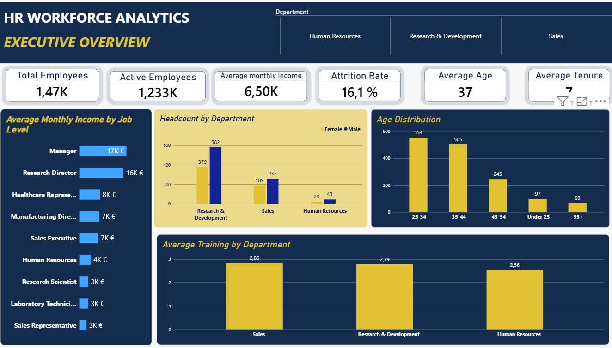
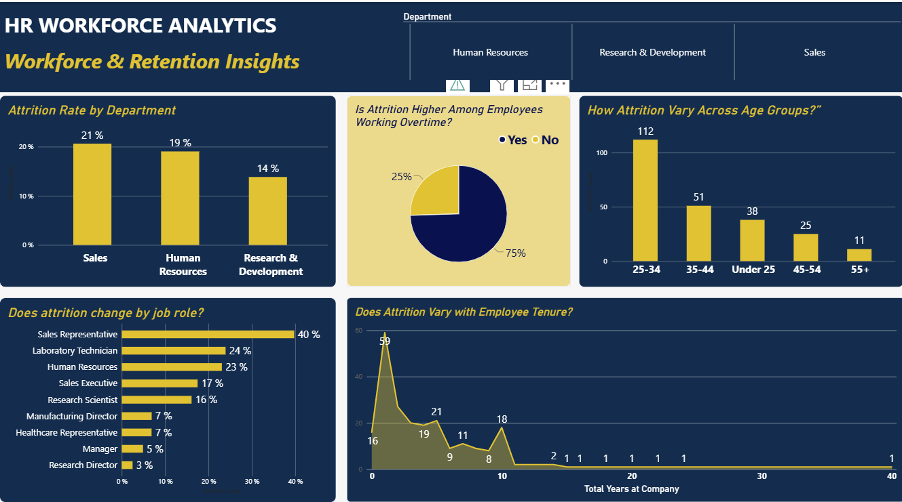

# HR Workforce Analytics | Python, Jupyter Notebook & Power BI

## Project Overview

This project explores workforce characteristics, employee attrition, job satisfaction and other HR indicators using a public synthetic employee dataset.

The project combines Python-based data quality assessment and exploratory data analysis in Jupyter Notebook with interactive reporting in Power BI.


**Tools:** Python, pandas, NumPy, Jupyter Notebook, Power BI

## Dashboard Preview

### Executive Overview



### Workforce Retention Insights



## Project Objectives

- Assess dataset quality, consistency and suitability for analysis.
- Explore workforce composition and employee characteristics.
- Investigate attrition patterns across age groups, departments, job roles and other employee attributes.
- Examine job satisfaction and selected workforce indicators.
- Develop an interactive Power BI report for segmented analysis.
- Document KPI definitions, methodological choices and data limitations.

## Repository Structure

```text
hr-workforce-analytics/
├── README.md
├── data/
│   ├── raw/
│   └── processed/
├── notebooks/
│   └── HR_Data_Quality_and_Exploratory_Analysis.ipynb
└── powerbi/
    ├── HR_Workforce_Analytics.pbix
└── powerbi_screenshots/
    ├── executive_overview.png
    └── workforce_retention_insights.png
```

## Dataset

The project uses the IBM HR Analytics Employee Attrition & Performance dataset, publicly available through Kaggle.

The dataset contains 1,470 employee records and 35 original columns. Three constant columns were excluded during preparation, leaving 32 columns for analysis.

The data is synthetic and must not be interpreted as representing actual employees or the workforce of the European Parliament or any other institution.

## Methodology

### 1. Data Quality Assessment — Python

The Jupyter Notebook documents the data inspection and preparation process, including:

- Dataset structure and data types.
- Missing-value assessment.
- Duplicate-record and employee-identifier checks.
- Constant-column identification.
- Category and value-range checks.
- Consistency checks between selected employment-related fields.


### 2. Interactive Reporting — Power BI

The Power BI report presents selected HR indicators through interactive visualisations and filters.

The report focuses on workforce composition, attrition patterns and employee-related indicators, with the aim of making comparisons across relevant employee groups easier to explore.

## KPI Definitions

- **Total Employees:** Number of distinct employee identifiers in the dataset.
- **Attrition Count:** Number of records where the attrition indicator is "Yes".
- **Attrition Rate:** Attrition count divided by the total number of employees in the analysed dataset.
- **Average Tenure:** Average number of years employees have spent at the company.
- **Average Monthly Income:** Mean value of the dataset's `MonthlyIncome` field.

These indicators describe the available dataset. The attrition rate is not an annual turnover rate because the dataset does not provide a time series of employee departures and workforce size.


To explore the dashboard, download `HR_Workforce_Analytics.pbix` and open it using Power BI Desktop.

Data source: IBM HR Analytics Employee Attrition & Performance dataset, available on Kaggle. Please refer to the original dataset page and its applicable licence for source and redistribution terms.

